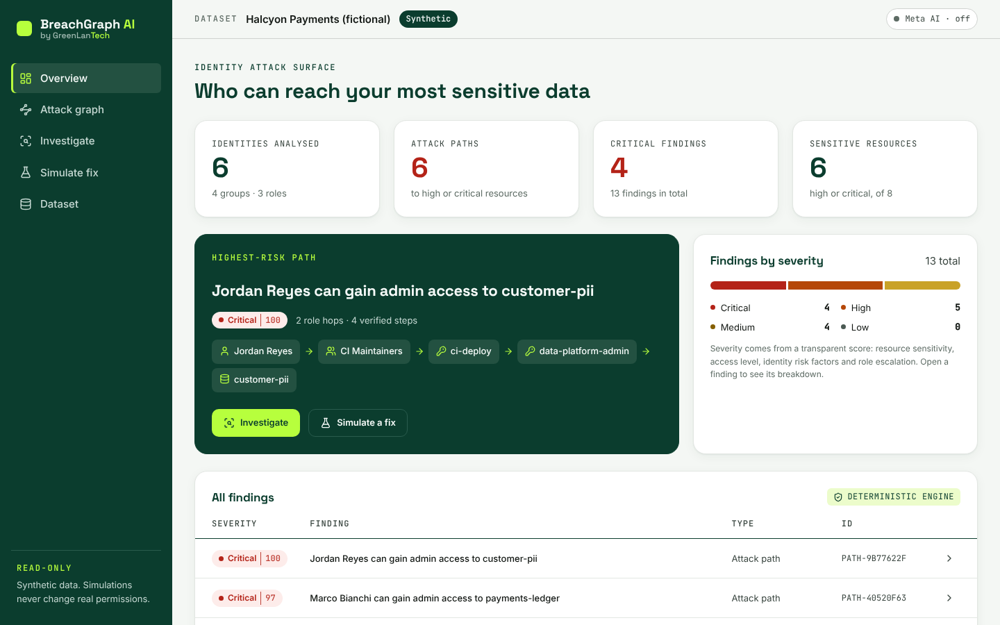
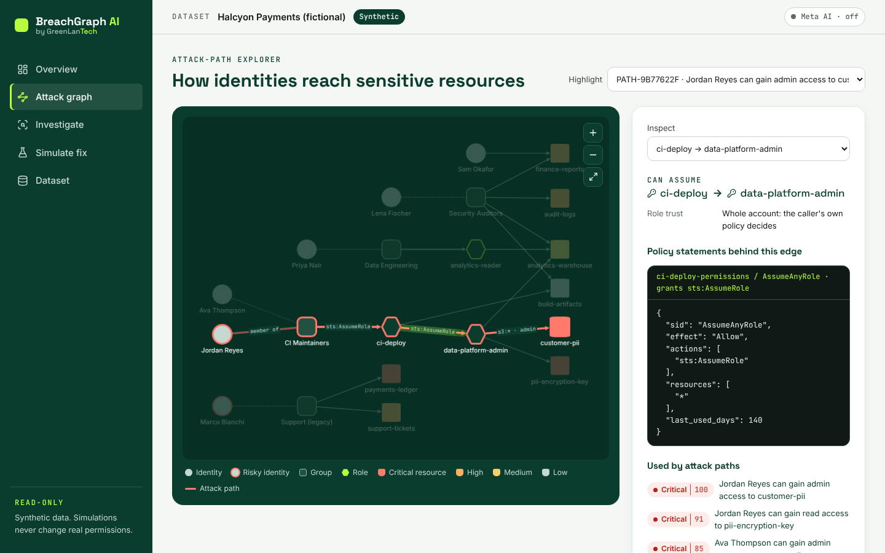
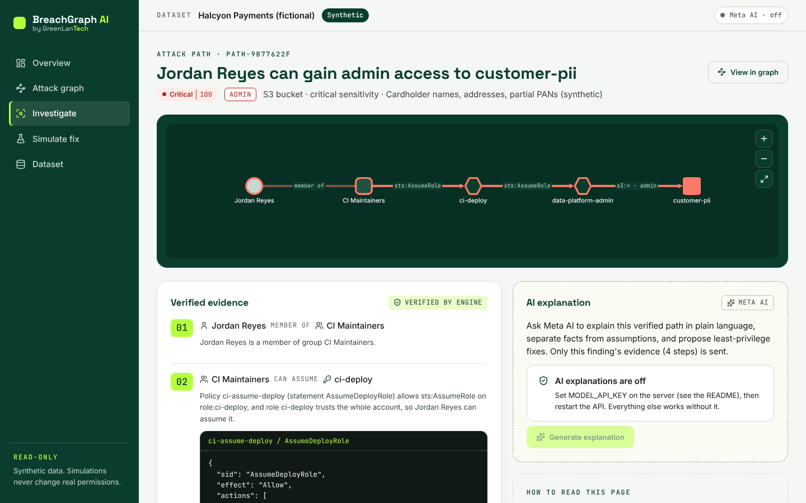
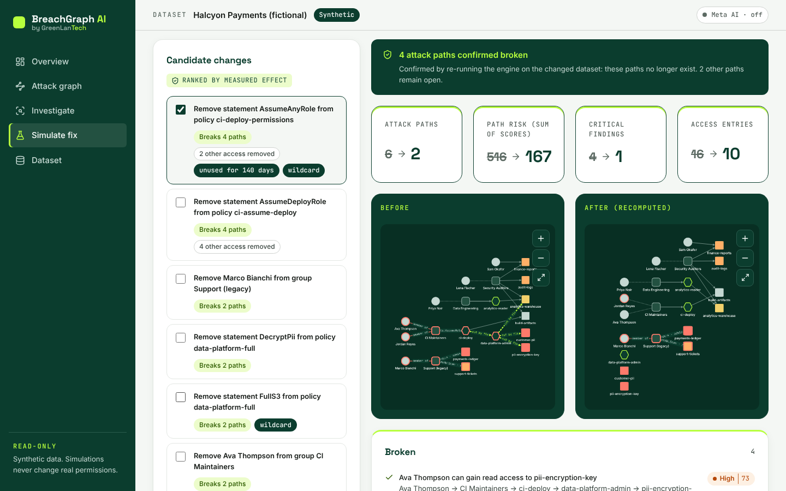
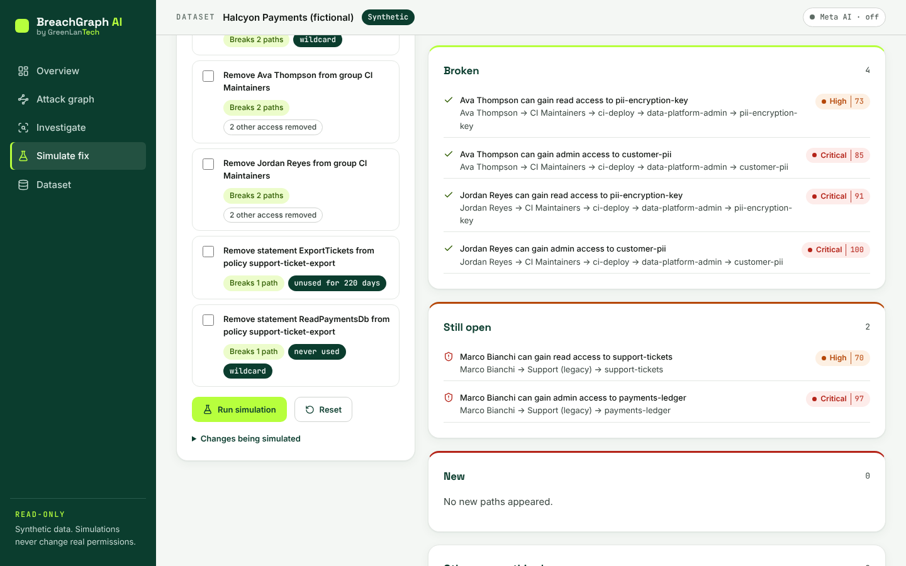
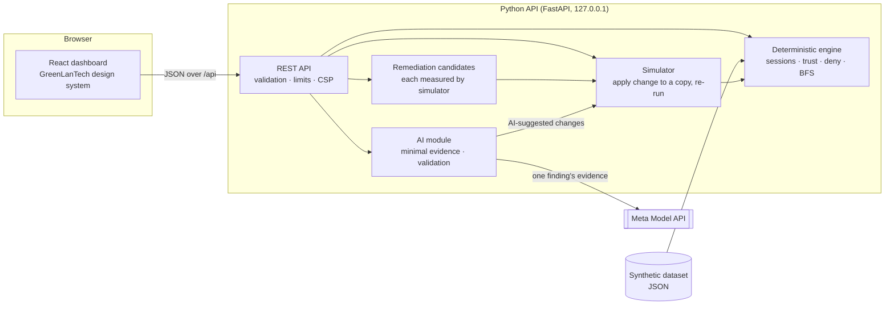

# BreachGraph AI

**Find out who can really reach your sensitive data, see the evidence, and test the fix before you make it.**

BreachGraph AI is a cloud identity security investigator from **GreenLanTech**. It maps how
users, groups, roles and permissions chain together into *attack paths* to sensitive
resources. A deterministic engine proves every step, and Meta AI explains the risk in plain
language. A simulator re-runs the analysis on a proposed least-privilege fix and shows
whether the path is really broken.



> **Built entirely during the Meta Global AI Developer Hackathon (26 Oct – 4 Nov 2026)** for
> the **"Build for Your World"** problem statement. Nothing in this repository existed before
> the event (see [Built during the hackathon](#built-during-the-hackathon)). It runs on
> **synthetic data only** and never connects to, reads from or changes a real cloud account.

---

## The problem

Over-privileged identities are among the most common causes of cloud breaches. They are
also hard to see. An excessive permission rarely sits on one account. It is spread across a
group membership, a role trust policy and a wildcard statement nobody has used for months.
Each piece looks harmless on its own. Together they let a contractor's laptop reach customer
data.

Most tools list findings one at a time. BreachGraph shows the **chain**, explains **why**
it matters, and answers the question a security engineer actually has: *"if I remove this
permission, is the path gone, and what else breaks?"*

## What it does

| | |
|---|---|
| **Attack-path analysis** | A deterministic Python engine follows group memberships and role assumptions (with AWS-style trust and explicit-deny rules) to find every route from an identity to a high or critical resource. |
| **Evidence for every edge** | Each step cites the exact policy statement or trust policy that allows it. Select any node or edge in the graph to see it. |
| **Transparent severity** | Scores are a visible sum of named factors (sensitivity, access level, MFA, external identity, inactivity, role escalation), not a black box. |
| **Meta AI explanations** | On request, Meta AI explains one verified finding: the risk, the likely impact, which statements are facts and which are assumptions, and least-privilege fixes. |
| **AI proposes, engine verifies** | Every fix the AI suggests is checked against the simulator before it is shown. You see whether it really breaks the path. |
| **Fix Agent** | A verifiable agent loop: Muse Spark proposes a least-privilege fix, the simulator measures it, and the measurement goes back to the model to refine, up to 4 rounds. Each round streams live to the dashboard. Only the simulator decides when a fix works. |
| **Remediation simulator** | Pick one or more changes and the whole analysis re-runs on a copy of the data. Before/after graphs, broken vs remaining paths, new paths, and *other access the change would remove*. |
| **Works without AI** | Analysis, graph, investigation and simulation all work with no API key. |

## Screenshots

All screenshots are of the running application with the bundled synthetic dataset
(captured with `frontend/e2e/screens.mjs`).

| Attack-path explorer | Investigation |
|---|---|
|  |  |

| Simulator: before and after | Simulator: path results |
|---|---|
|  |  |

The AI panel shows "AI explanations are off" because the screenshots were taken without an
API key. No AI output appears in the screenshots.

---

## Quick start

Requirements: **Python 3.11+** and **Node.js 20+**. No cloud account, no paid services and no
API key are needed for the demo.

### macOS / Linux

```bash
git clone https://github.com/cyber39glt/breachgraph-ai.git
cd breachgraph-ai

# 1. Backend
cd backend
python3 -m venv .venv
source .venv/bin/activate
pip install -e ".[dev]"
pytest -q                                    # expect: 92 passed

# 2. Dashboard (build once; the API serves it)
cd ../frontend
npm ci
npm test                                     # expect: 17 passed
npm run build

# 3. Run
cd ../backend
uvicorn breachgraph.api:app --host 127.0.0.1 --port 8000
```

Open **http://127.0.0.1:8000**. The synthetic demo dataset loads automatically.

### Windows (PowerShell)

```powershell
git clone https://github.com/cyber39glt/breachgraph-ai.git
cd breachgraph-ai\backend
py -3 -m venv .venv
.\.venv\Scripts\Activate.ps1
pip install -e ".[dev]"
pytest -q

cd ..\frontend
npm ci
npm test
npm run build

cd ..\backend
uvicorn breachgraph.api:app --host 127.0.0.1 --port 8000
```

If PowerShell blocks `Activate.ps1`, run
`Set-ExecutionPolicy -Scope Process -ExecutionPolicy Bypass` in that window first.

### Troubleshooting

| Symptom | Cause and fix |
|---|---|
| `ImportError: DLL load failed while importing _pydantic_core` | A pre-release Python (for example `3.14.0a4`) is installed. Check with `python --version`; an `a`, `b` or `rc` in the version means a test build. Install a stable Python (3.12 or 3.13 are tested), then recreate the environment: `Remove-Item -Recurse -Force .venv`, `py -3.13 -m venv .venv`, and install again. |
| PowerShell: "running scripts is disabled" | Run `Set-ExecutionPolicy -Scope Process -ExecutionPolicy Bypass` in that window, answer `Y`, then activate again. It affects only that window. |
| Dashboard says **Meta AI · off** | The server did not see `MODEL_API_KEY`. Set it in the **same** terminal **before** starting `uvicorn`, or put it in `.env`, then restart the server and refresh the page. |
| `live_ai_check.py` says `not_found` | Your account uses a different model id. Run `--list-models` and set `MODEL_NAME`. |

### Frontend development mode

Run the API as above, then in a second terminal run `cd frontend && npm run dev` and open
**http://127.0.0.1:5173**. Vite reloads on save and forwards `/api` to port 8000.

### Command line

```bash
cd backend
python -m breachgraph.cli ../data/sample_org.json
python -m breachgraph.cli ../data/sample_org.json --fix ../data/fixes/signature_fix.json
```

---

## Configure the Meta Model API (optional)

AI explanations use the **Meta Model API**. It is OpenAI-compatible (`POST /chat/completions`
with a Bearer token). The key is read **only on the server**, from the `MODEL_API_KEY`
environment variable. The browser never sees it.

| Variable | Default | Purpose |
|---|---|---|
| `MODEL_API_KEY` | *(empty: AI off)* | Your Meta Model API key |
| `MODEL_API_BASE_URL` | `https://api.meta.ai/v1` | API base URL |
| `MODEL_NAME` | `muse-spark-1.3` | Model id |
| `MODEL_TIMEOUT_SECONDS` | `30` | Request timeout |

**Option A: a `.env` file (recommended).** Copy `.env.example` to `.env` in the project
root and put your key after `MODEL_API_KEY=`. `.env` is git-ignored.

```bash
cp .env.example .env            # macOS / Linux
```
```powershell
Copy-Item .env.example .env     # Windows
```

**Option B: an environment variable for the current terminal only.** Type the key yourself;
never paste it into chat, issues or code.

```bash
read -rs MODEL_API_KEY && export MODEL_API_KEY      # macOS / Linux (input is hidden)
```
```powershell
$env:MODEL_API_KEY = Read-Host "Meta Model API key" -MaskInput   # PowerShell 7+
```

**Check the connection** before the demo. This makes at most one small request and never
prints the key:

```bash
cd backend
python scripts/live_ai_check.py --list-models   # which model ids your key can use
python scripts/live_ai_check.py                 # one real explanation of the top finding
```

The endpoint and model id above follow Meta's Model API documentation (dev.meta.ai) and
were confirmed with a live call during the hackathon. If your account uses something
different, the live check will tell you; then set `MODEL_API_BASE_URL` or `MODEL_NAME`.

**Credit safety.** Nothing calls the model automatically. A call happens only when you press
*Generate explanation* or *Run Fix Agent*. Explanations are cached per finding, and the server
allows at most 6 explanations and 2 Fix Agent runs (up to 4 calls each) per minute.

---

## How it works



### The risk engine (`backend/breachgraph/engine.py`)

1. **Sessions follow AWS rules.** A user's session holds the user's policies plus the user's
   groups' policies. An assumed role holds only the role's own policies, so a deny on the
   user does not carry into the role, just as in AWS.
2. **Role trust.** A trust policy that names a principal is enough on its own. Trust in the
   whole account (`account:*`) hands the decision to the caller's `sts:AssumeRole` permission.
   Like AWS, trust policies cannot name groups.
3. **Explicit Deny wins** when it fully covers an allowed action. A partial overlap is treated
   as still allowed, so the engine errs towards reporting a path rather than hiding one.
4. **Search.** Breadth-first search over role assumptions finds the shortest chain to each
   role, with a hop limit and protection against cycles.
5. **Findings.** A reach becomes an attack-path finding when the target is high or critical
   *and* it needs a role chain or starts from a risky identity. Wildcard and long-unused
   statements are reported separately and linked to the paths they enable.

### The Meta AI integration (`backend/breachgraph/ai.py`)

- **The engine decides; the AI explains.** The client sends only a finding id. The server
  looks the finding up in its own analysis, so a client cannot inject fake evidence.
- **Minimal evidence.** Only that finding's steps, policy statements, entry identity
  attributes and target resource go to the model, not the whole dataset.
- **Grounded output.** The prompt requires JSON with separate `facts_used`, `assumptions`
  and `uncertainties`, and treats dataset text as data, not instructions.
- **Validated output.** Replies are parsed, type-checked and length-capped. Anything
  malformed is discarded with an error. There is no fallback text pretending to be AI.
- **No actions.** Suggested changes must be one of six simulator operations. Each is run
  through the simulator, and the UI shows whether it breaks the path. Nothing is ever
  applied to a real system.
- **Errors are mapped and safe.** Missing key, bad credentials, unknown model, rate limits,
  timeouts, network failures and malformed replies each get a clear message. Upstream error
  bodies are never passed on, and the key never appears in responses or logs (both tested).

### The Fix Agent (`backend/breachgraph/agent.py`)

A bounded, verifiable agent loop. Each round:

1. **Propose.** Muse Spark receives the verified path, the policies it could change, and the
   simulator's operation vocabulary. It replies with up to 3 changes as JSON, plus its reasoning.
2. **Verify.** The changes are validated and run through the simulator on a copy of the data.
   The measurement records whether the target path broke, whether new paths appeared, and
   what other access would be lost.
3. **Feed back.** That measurement, including any rejection such as an unknown id, is sent
   back to the model, which refines its proposal.

The loop stops when the model is done and a verified fix exists, when a fix breaks the path
with no other access removed, or after 4 rounds. **The model's own claims never count:** a
fix is accepted only if the simulator confirms it breaks the target path and opens no new
ones. Among accepted rounds, the agent keeps the one that removes the least other access.
Rounds stream to the dashboard as newline-delimited JSON (`POST /api/agent/fix`). If the API
fails mid-run, the verified rounds are kept and the failure is reported.

### The simulator (`backend/breachgraph/simulate.py`)

Changes (`remove_statement`, `remove_group_member`, `detach_policy`,
`set_statement_actions`, `set_statement_resources`, `set_role_trust`) are applied to a deep
copy. The copy is re-validated and fully re-analysed. A path is reported as **broken** only
if it is absent from the recomputed result. The simulator also reports new paths and *other
access the change removes*, so you can spot collateral damage to legitimate work.

---

## Sample investigation (bundled synthetic dataset)

`data/sample_org.json` describes **Halcyon Payments**, a fictional company: 6 identities,
4 groups, 3 roles, 8 resources (6 high or critical). All names and data are invented.

The engine reports 6 attack paths and 13 findings (4 critical, 5 high, 4 medium). The
highest-risk path:

```
Jordan Reyes (contractor, no MFA)
  01 member of        CI Maintainers
  02 can assume       ci-deploy             ci-assume-deploy / AssumeDeployRole
  03 can assume       data-platform-admin   ci-deploy-permissions / AssumeAnyRole
                                            (sts:AssumeRole on "*", last used 140 days ago)
  04 admin access     customer-pii          data-platform-full / FullS3 (s3:*)
```

Score 100 / critical: critical resource +60, admin +20, no MFA +10, external +8, role
escalation +5 (103, capped at 100).

**Fix:** remove the unused `AssumeAnyRole` statement (`data/fixes/signature_fix.json`).
It is the top-ranked candidate in the simulator.

| | Before | After (recomputed) |
|---|---|---|
| Attack paths | 6 | 2 |
| Path risk (sum of scores) | 516 | 167 |
| Critical findings | 4 | 1 |
| New paths | | 0 |

- **Broken:** 4 paths. Jordan Reyes and Ava Thompson lose their routes to customer-pii and
  pii-encryption-key.
- **Still open:** 2 paths through the separate legacy-support group (Marco Bianchi, inactive
  214 days). They need their own fix, and the simulator says so.
- **Other access removed:** admin on `analytics-warehouse` for both CI users, which they
  could only reach through the same escalation. CI keeps its everyday deploy access to
  `build-artifacts`.

---

## Testing

| Suite | Command | Result (this commit) |
|---|---|---|
| Engine, simulator, API, AI integration, Fix Agent | `cd backend && pytest -q` | 92 passed |
| Dashboard components and workflows | `cd frontend && npm test` | 17 passed |
| Type check and production build | `cd frontend && npm run build` | passes |
| Live browser check (console errors, CSP, screenshots) | `node frontend/e2e/screens.mjs <outdir>` with the API running | no errors |

- AI tests use mocked HTTP replies (`httpx.MockTransport`). They need **no key and make no
  network calls**. They cover success, every error class, malformed output, response
  validation, prompt minimality, caching, rate limiting, and that the key never appears in
  responses or logs.
- Dashboard tests use fixtures **exported from the real engine**
  (`backend/scripts/export_fixtures.py`), not hand-written data.
- The live Meta API check (`backend/scripts/live_ai_check.py`) is separate and opt-in.
- The browser check needs Playwright: `npm i -D playwright && npx playwright install chromium`.

---

## Security considerations

- **Synthetic data only.** BreachGraph never connects to a cloud provider. There is no code
  that could change real permissions; the simulator works on an in-memory copy.
- **Secrets.** The API key lives only in the server environment or a git-ignored `.env`. It
  is never sent to the browser, returned in responses, logged or included in errors.
- **Input validation.** Request bodies are capped at 1 MB. Datasets are size-limited and
  strictly validated, and unknown request fields are rejected. Finding ids must match a
  strict pattern.
- **Browser hardening.** A strict Content-Security-Policy (`default-src 'self'`, no inline
  scripts or styles), `nosniff`, `no-referrer` and `frame-ancestors 'none'`. Fonts are
  self-hosted, so no third-party requests are made.
- **Local by default.** The server binds to `127.0.0.1`. There is no authentication, so do
  not expose it to a network as it stands.

## Limitations

- **Simplified IAM model.** No resource-based policies, permission boundaries, SCPs,
  conditions, `NotAction`/`NotResource`, or session policies, and actions are not checked
  against resource types. Results describe the dataset's model, not a real account.
- **Partial-deny overlaps** are treated as allowed (over-reporting rather than hiding).
- **Scores are a prioritisation heuristic**, not a likelihood of compromise.
- **"Last used" and "last login"** values come from the dataset; nothing is collected live.
- **AI explanations** can still be wrong or incomplete even after validation. They are
  labelled, and their facts should be checked against the verified evidence on the same
  page.
- **The automated tests do not call the live API.** They use mocked responses, so they need
  no key. A live connection to `muse-spark-1.3` at `https://api.meta.ai/v1` was confirmed
  with `scripts/live_ai_check.py` (PASS) on 30 Oct 2026. The model's wording varies between
  runs, and availability depends on your account's access and credits.
- This is a hackathon prototype, **not a production security product**.

## Future work

- Read-only importers for AWS IAM Access Analyzer / Azure Entra exports, so real data can be
  analysed offline.
- Resource policies, permission boundaries and condition keys.
- Least-privilege policy *generation* (narrowing wildcards to the actions actually used),
  verified by the simulator.
- Exportable investigation reports and ticket integration.

## Project structure

```
backend/
  breachgraph/   engine.py · simulate.py · remediation.py · ai.py · api.py · model.py · cli.py
  tests/         pytest suites (engine, API, AI with mocked replies)
  scripts/       live_ai_check.py · export_fixtures.py
frontend/
  src/           React app (pages/, components/, styles/tokens.css = design tokens)
  e2e/           Playwright screenshot and console/CSP check
data/            sample_org.json (synthetic) · fixes/
docs/            architecture.md · demo-script.md · design-system.md · screenshots/
```

## Built during the hackathon

Every file in this repository was created during the event, which opened with the kickoff
on Mon 26 Oct 2026 at 12:00 PM ET. No earlier codebase was reused. The repository itself was
created on 27 Oct. Commits, in Eastern Time:

| When (ET) | Commit | What was built |
|---|---|---|
| Mon 26 Oct, 15:21 | `19fd2f7` | Synthetic dataset, deterministic risk engine, remediation simulator, CLI, tests |
| Tue 27 Oct, 05:59 | `481c96b` | REST API, remediation candidates, Meta Model API integration |
| Tue 27 Oct, 06:14 | `ba87b08` | GreenLanTech dashboard: graph explorer, investigation, simulator |
| Tue 27 Oct, 06:17 | `92b698a` | Documentation, demo script, CI |
| Wed 28 Oct onward | later commits | Licensing, live Meta API confirmation, troubleshooting, further features |

Third-party open-source libraries (listed in [NOTICE](NOTICE)) are used unmodified as
dependencies. The GreenLanTech brand belongs to the author.

## Licence

[Apache License 2.0](LICENSE). Third-party components and font licences are listed in
[NOTICE](NOTICE). The GreenLanTech name and visual identity are not covered by the licence.

---

BreachGraph AI · a GreenLanTech project
