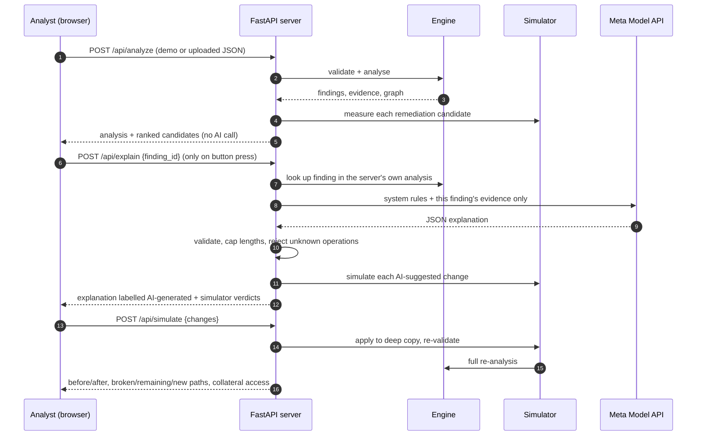

# Architecture

BreachGraph AI is a small two-tier application: a Python API that holds all security logic,
and a React dashboard that only displays results. There is no database. Each request carries a
dataset (or uses the bundled synthetic demo), and results are recomputed deterministically.

## Modules

| Module | Responsibility | AI involved? |
|---|---|---|
| `model.py` | Load and strictly validate datasets (ids, references, AWS trust rules) | No |
| `engine.py` | Sessions, trust, deny, BFS over role chains, findings, scores, graph | No |
| `simulate.py` | Six change operations on a copy; diff of paths and access | No |
| `remediation.py` | Candidate cuts on attack paths, each measured by the simulator | No |
| `ai.py` | Evidence bundle, prompt, Meta Model API call, error mapping, output validation, simulator verification | Yes (explain only) |
| `agent.py` | Fix Agent loop: model proposes changes, simulator verifies, measured feedback to the model | Yes (proposals only) |
| `api.py` | HTTP endpoints, request limits, security headers, credit protection, static dashboard | No |

## API

| Method | Path | Purpose |
|---|---|---|
| GET | `/api/health` | Status and whether an AI key is configured (never the key) |
| GET | `/api/demo/dataset` | The synthetic demo dataset |
| POST | `/api/analyze` | Findings, evidence, graph, ranked remediation candidates |
| POST | `/api/simulate` | Before/after analysis for 1–20 changes |
| POST | `/api/explain` | Meta AI explanation for one attack-path finding |
| POST | `/api/agent/fix` | Fix Agent: streams propose → simulate → feedback rounds (NDJSON) |

Interactive docs: `http://127.0.0.1:8000/api/docs`.

## Key decisions

1. **Deterministic first.** Security conclusions must be reproducible and testable, so no
   finding depends on a model.
2. **Server-side AI only.** Keeps the key off the client and lets the server control exactly
   what evidence leaves the machine.
3. **Verification loop.** AI suggestions are untrusted input. They are constrained to a small
   operation vocabulary and measured by the simulator.
4. **No persistence.** Nothing to secure at rest. The datasets are synthetic and small.
5. **Strict CSP over convenience.** Self-hosted fonts, no inline styles, and a workaround for
   Cytoscape's injected stylesheet (see `frontend/index.html`).
